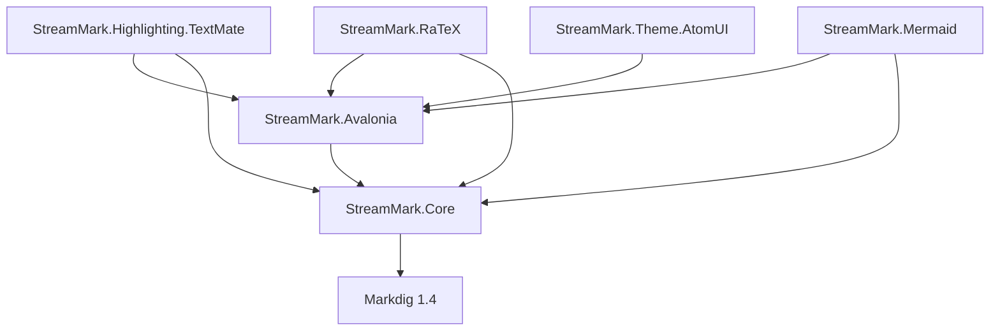

# 架构

StreamMark 是库 + 示例的单一 .NET 10 进程：没有服务端、没有 WebView、没有 JS 运行时。桌面端只有 Avalonia 12。

## 运行时与线程

| 运行时 | 说明 |
|---|---|
| 后台单逻辑工作者 | 解析在同一个逻辑工作者上串行执行（`StreamingDocument` 的提交队列 + 脏标记合并）；并发到达的追加只置脏，当前轮结束后处理最新文本，中间版本被跳过 |
| 界面线程 | 每帧最多取一次 `Document.Latest`，按 `SnapshotDiff` 应用差异；逐行排版（`SegmentLayout`）与行视觉录制在这里。末尾渐显不在这里画：`TailFade` 在渲染线程的自定义视觉里逐帧绘制 |
| 第三方后台任务 | 代码高亮、公式排版、图表渲染、图片加载各自在后台跑，回投前校验身份/代次（`CodeBlockState.RunHighlight`、`DiagramBlockView.StartRender`、`ImageSlot.Load`） |
| 原生代码 | RaTeX（Rust）以 C ABI 动态库形式在进程内调用，库文件必须与二进制同目录或由 NuGet 包按 RID 提供 |

## 分层与依赖方向

允许的方向是单向的：`Core` → 只依赖 Markdig；`Avalonia` → `Core`；扩展包与主题包 → `Avalonia`（+ `Core`）。**`Avalonia` 与 `Core` 不得反向引用任何扩展包或主题包**，扩展接入一律通过 `Plugins/` 与 `Extensions/` 里的接口注册（`IMathRenderer`、`ISyntaxHighlighter`、`IDiagramRenderer`、`ISvgRasterizer`）。`ISyntaxHighlighter` 契约本身在 `Core`，实现才在扩展包里。

不可跨越的边界：

- `Core` 不得引入 Avalonia 或 UI 类型（它要被无头测试与基准直接驱动）。
- 解析不得在界面线程调用（`DocumentComposer.Parse` 只在工作线程）。
- 扩展包不得让 `Avalonia` 认识自己的类型——`MarkdownServices.Plugins` 是唯一通道。
- 主题只经 `Md.*` 资源键与 `MarkdownResourceAlias` 暴露；扩展包不读宿主资源。

## 新代码放哪里

| 要加的东西 | 位置 | 入口 |
|---|---|---|
| 新的解析/切分/快照规则、remend 处理器 | `src/StreamMark.Core/` 对应子目录 | [core-streaming.md](modules/core-streaming.md)、[core-parsing-and-model.md](modules/core-parsing-and-model.md)、[remend-and-offsetmap.md](modules/remend-and-offsetmap.md) |
| 新的块类型或块视图 | 模型 `Core/Model/Blocks.cs` + 视图 `Avalonia/Rendering/` | [avalonia-text-rendering.md](modules/avalonia-text-rendering.md) |
| 新的 HTML 白名单标签 / CSS 属性 | `Core/Parsing/ComponentSpec.cs`、`Core/Html/` | [raw-html-render.md](flows/raw-html-render.md) |
| 会话（虚拟化列表、行模型、滚动）行为 | `Avalonia/Transcript/` | [avalonia-transcript.md](modules/avalonia-transcript.md) |
| 选区、复制格式 | `Avalonia/Selection/` | [text-selection-copy.md](flows/text-selection-copy.md) |
| 图片加载 / 缓存 / 策略 | `Avalonia/Images/` | [avalonia-images.md](modules/avalonia-images.md) |
| 第三方渲染能力（高亮、公式、图表） | 新包或对应扩展包，提供 `IMarkdownPlugin` | [avalonia-extensions.md](modules/avalonia-extensions.md) |
| 宿主可定制的视觉 | `Md.*` 资源键 + 主题 | [theme-resolution.md](flows/theme-resolution.md) |
| 原生库、构建脚本、CI | `native/`、根 `Directory.*`、`.github/workflows/` | [native-ratex.md](modules/native-ratex.md)、[build-and-packaging.md](modules/build-and-packaging.md) |
| 示例与性能基准 | `samples/`、`bench/` | [gallery-and-benchmarks.md](modules/gallery-and-benchmarks.md) |

## 真相来源

- 文档内容的真相是只追加的源码缓冲（`StreamingDocument`），块与选区都以「原始源码偏移」为身份；任何副本（块模型、快照、行模型）都从它派生。
- 视觉样式的真相是 Avalonia 资源里的 `Md.*` 键；`MarkdownStyle` 是解析后的不可变快照，只有 `MarkdownView` 与 `TranscriptPanel` 持有并下发。
- 失败呈现：解析异常被 `StreamingDocument.Run` 静默吞掉并保留旧快照（界面表现为停止更新），高亮异常被 `CodeBlockState.RunHighlight` 丢弃；界面层只处理「有差异就应用」，没有重试通道。

## 相关

- 业务概念到代码/存储/界面的映射：[domain.md](domain.md)
- 模块与流程清单：[index.md](index.md)
