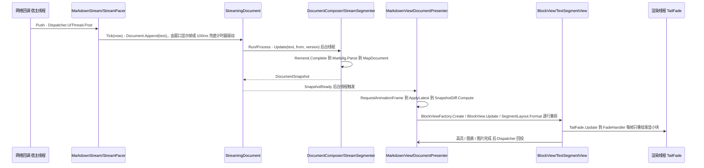

# 一个 token 从网络回调到屏幕上的块视图

**Trigger:** 宿主在任意线程调用 `StreamingDocument.Append`（生产路径是 `MarkdownStream.Push` → `StreamPacer.Tick`）  **Outcome:** 稳定块被冻结且只解析一次，尾部每个快照重做补全 + 解析；界面线程每帧最多应用一次差异；块视图按 key 复用；未闭合语法已补全；末尾片段在**渲染线程**上逐字渐显并显示光标。

> 本页按 HEAD `8d344a6` 重写并逐条重新核对（此前写作时是 `349b77f`）。相对上一版，结构与步骤编号不变，但**节奏推进、文本排版与末尾渐显三处已经换实现**：`MarkdownStream` 改由窗口显示帧（`SetFrameSource`）推进 `StreamPacer`，文本片段改由 `SegmentLayout` 逐行排版并从差异点所在行的前一行重排，末尾渐显从「每帧界面线程重绘」改成渲染线程上的 `TailFade` 合成视觉。上一版里「`TextRunCache` 从差异点所在段落起点失效」的说法仍然成立，但它已经**不是流式排版的主路径**——流式增量现在由 `SegmentLayout` 的逐行重排承担。

## Steps
1. `src/StreamMark.Avalonia/MarkdownStream.cs:MarkdownStream.Push` — 任意线程的分片先 `Dispatcher.UIThread.Post`（:66）切到界面线程；已请求完成时静默丢弃（:68-71）；置 `State.IsActive = true`；`_smooth` 为假时直接 `Document.Append(text)` + `State.RecordReveal(text.Length, StreamClock.Now)`（:75-76）；为真时 `_pacer.Push(text, StreamClock.Now)`（:80），且**只在当前没有排定的帧时**立刻 `Tick()`（`idle = !_tickScheduled`，:79/:83）(`avalonia-text-rendering`)
2. `src/StreamMark.Avalonia/MarkdownStream.cs:MarkdownStream.ScheduleTick` / `RunScheduled` — 节奏由**窗口显示帧**推进：视图每次 `ApplyLatest` 都调 `Stream?.SetFrameSource(TopLevel.GetTopLevel(this))`（`MarkdownView.cs:168`），于是 `ScheduleTick`（:135）走 `top.RequestAnimationFrame(_ => RunScheduled(generation))`（:145）并把计时器间隔放宽到 `FrameFallback = 100ms`（:29/:146）兜底；**没有帧来源**（未挂载、最小化、无头环境）时用 16ms `DispatcherTimer`（:150，构造在 :37）。`_tickScheduled` + `_tickGeneration`（:25-26）保证同一时刻只有一个排定的帧，`RunScheduled`（:155）校验代号后 `Tick()`；`Finish` 停表（:168）(`avalonia-text-rendering`)
3. `src/StreamMark.Core/Pacing/StreamPacer.cs:StreamPacer.Tick` — 本帧放出量 = `max(_rate, Backlog / TargetLag)`（:161），`MaxLag`（默认 400ms）用到达队列兜底强制放出（:170-178），`BypassThreshold`（4096）整段放出（:156）；`Push` 在积压为 0 时清空 `_lastTick`（:118-122），使空闲后的第一帧按 1/60s 计而不是把空闲时长算进去（:148）。`StreamPacer.Release`（:219）只在字素簇边界切（`StringInfo.GetNextTextElementLength`，:231），未结束时末尾的高代理字符留到下一帧（:238）(`core-streaming`)
4. `src/StreamMark.Avalonia/MarkdownStream.cs:MarkdownStream.Tick` — `Document.Append(text)`，紧接着 `State.RecordReveal(text.Length, now)`（:122-123）把这一批的显示时间写进渐显队列（`StreamingState.cs:31`）；`Backlog > 0` 继续 `ScheduleTick()`，积压排空且已请求完成时 `Finish()`（:125-132）
5. `src/StreamMark.Core/Streaming/StreamingDocument.cs:StreamingDocument.Append` — 在 `_sourceLock` 下追加进 `_source`、`_version++`（:77-78），再 `Schedule()`（:199）：置 `_dirty`，若已有工作者在跑就直接返回，否则 `ThreadPool.UnsafeQueueUserWorkItem(Run)`（:210）(`core-streaming`)
6. `src/StreamMark.Core/Streaming/StreamingDocument.cs:StreamingDocument.Run`/`TakeWork` — 后台单线程合并：`TakeWork`（:237）在一轮解析结束后才取下一个脏标记，所以解析期间到达的追加只置脏、中间版本被整体跳过；`_source` 与工作线程之间只交换"从 `from` 起的剩余文本"（:277）
7. ⇢ crosses thread boundary via `Volatile.Write(ref _latest)` + `SnapshotReady`（在**后台线程**触发，`StreamingDocument.cs:230-231`）
8. `src/StreamMark.Core/Streaming/StreamingDocument.cs:StreamingDocument.Process` — 源码代变化（`Reset`）→ `_composer.Reset()`；`version == _processedVersion` 或 `_finished` → 返回 null；否则 `complete ? 0 : _composer.FrozenEnd` 取起点并把 `[from, 末尾)` 切片（:263-277），交给 `DocumentComposer.Update` 或 `Finish`（:286）
9. `src/StreamMark.Core/Streaming/StreamSegmenter.cs:StreamSegmenter.Advance` — 逐**完整行**扫描推进冻结边界（:69）；未结束的最后一行只在 `IsDecisive`（:310）判定明确时提前提交边界，不改扫描状态。`TryCommit`/`CanCut`（:260/:273）是守卫：`SawDefinition`、下一行有缩进、`:` 开头、列表后跟新列表项、setext 下划线一律不切；`boundary <= FrozenEnd` 直接返回，边界只前进（:262）(`core-streaming`)
10. `src/StreamMark.Core/Streaming/DocumentComposer.cs:DocumentComposer.Update` — 只把新冻结区间 `[oldFrozen, newFrozen)` 解析一次（:66-72），之后所有快照直接复用这些块对象（同代内不会重解析）
11. `src/StreamMark.Core/Streaming/DocumentComposer.cs:DocumentComposer.Update` — 尾部先走未闭合围栏快速路径：`StreamSegmenter.TryGetOpenFence`（:81，探针在 `StreamSegmenter.cs:111`，要求 `_fenceStartsRun` 且未结束的最后一行不构成闭合围栏）命中时由 `OpenCodeBlock`（:118）手工按行构造 `CodeBlock{ IsFenced = true, IsOpen = true }`，并复刻 remend 的"去末尾单空格"规则（:121-124）；否则 `Parse(text[tailStart..], newFrozen, _tailOptions)`（:88），`_tailOptions` 已合并 `MarkdownProfile.RemendHandlers`（:46）
12. `src/StreamMark.Core/Streaming/DocumentComposer.cs:DocumentComposer.SettledOptions` + `DocumentComposer.Parse` — 冻结片段与整篇解析用的是"只保留位置无关转义修正"的选项（`SingleTilde` / `ComparisonOperators` 为真，粗体 / 链接 / Katex / setext 等全部 false，:21-34），不补全尾部；随后 `RemendHealer.Complete` → `Markdown.Parse` → `MarkdigMapper.MapDocument`（:111-116）(`remend-and-offsetmap`, `core-parsing-and-model`)
13. `src/StreamMark.Core/Remend/Remend.cs:Remend.Complete` — 按优先级执行启用的内置 handler（末尾单空格 / 比较运算符 / HTML 标签 / setext / 链接图片 / 粗斜体 / 粗体 / 斜体 / 行内代码 / 删除线 / Katex / inlineKatex，:145-172；末尾单空格在 :208 先剥掉）；输出以 `streammark:incomplete-link` / `incomplete-image` 结尾时提前返回（`EndsWithIncompleteMarker`，:198）；`RemendOptions.InlineKatex` 默认关闭（`Remend.cs:50`）(`remend-and-offsetmap`)
14. `src/StreamMark.Core/Parsing/OffsetMap.cs:OffsetMap.Create` — 双指针贪心对齐 raw / healed，把 remend 插入的反斜杠与零宽空格记成插入点（:40-49）；第一次无法对齐的位置之后（末尾被改写部分）统一映射到原文末尾（`ToSource`，:60-73）。`MarkdigMapper.RangeOf`（`MarkdigMapper.cs:198`）据此写 `SourceRange`，未闭合围栏 / 公式块直接拉到被解析文本末尾（:201-205）
15. `src/StreamMark.Core/Model/Blocks.cs:MarkdownBlock.Key` — `Key => Range.Start`（:18）：块在源码中的起点即它在差异与界面状态里的身份；源码只追加，所以同一块跨快照 key 稳定(`core-parsing-and-model`)
16. `src/StreamMark.Core/Streaming/DocumentSnapshot.cs:DocumentSnapshot` — 快照 = 不可变 `AppendOnlyList<MarkdownBlock> _frozen` 的引用 + `FrozenCount` + 尾部 `ImmutableArray`（:13-26）；同代内后一快照的前 `FrozenCount` 个块与前一快照是**同一对象**（`SharesFrozenWith`，:55），冻结前缀零拷贝共享（底层 `AppendOnlyList` 的分块永不移动，`AppendOnlyList.cs:3`）(`core-streaming`)
17. `src/StreamMark.Avalonia/MarkdownView.cs:MarkdownView.OnSnapshotReady` — 只做 `Dispatcher.UIThread.Post(RequestFrame, DispatcherPriority.Render)`（:140）；`RequestFrame` 用 `_frameRequested` 合帧 + `TopLevel.RequestAnimationFrame`（:142-158）→ 界面线程每帧最多一次 `ApplyLatest`
18. `src/StreamMark.Avalonia/MarkdownView.cs:MarkdownView.ApplyLatest` — 取 `document.Latest`，懒建 `RenderContext`（`CreateContext` :172），`Stream?.SetFrameSource(TopLevel.GetTopLevel(this))`（:168）把这条流接到当前窗口的显示帧上，再交给 `DocumentPresenter.Apply`（:169）；会话场景走同一形状但一次覆盖所有条目：`TranscriptPanel.ApplyAll`（`TranscriptPanel.cs:379`，订阅 `SnapshotReady` 在 :297，合帧在 :332-346，逐条 `markdown.Stream?.SetFrameSource(top)` 在 :389）(`avalonia-transcript`)
19. `src/StreamMark.Core/Streaming/SnapshotDiff.cs:SnapshotDiff.Compute` — 同代且共享冻结列表时起点 `start = min(previous.FrozenCount, next.FrozenCount)`（:28），其后按 `Key` 归并：同 key 且类型 / `Range` / `ComputeFingerprint()` 有变化才发 `Update`（:37-38，指纹故意不含 `Range`）；`DiffOp.Index` 是"正在变换的列表"中的位置（:12-15）；跨代（`Reset` / `Complete`）退化为从 0 的全量比较
20. `src/StreamMark.Avalonia/Rendering/DocumentPresenter.cs:DocumentPresenter.Apply` — `Insert`：`BlockViewFactory.Create` + `view.Update` + `_views.Insert` + `_insert(index, view)`（:39-47）；`Update`：`CanReuse` 为真就原地 `Update`（保住控件状态与输入焦点），否则移除并新建替换（:48-66）；`Remove`：`_remove` + `_views.RemoveAt`（:67-70）；`Context` 引用变了则 `Restyle` 按原模型全量重应用（:83）
21. `src/StreamMark.Avalonia/MarkdownView.cs:MarkdownView`（构造函数 :48）— presenter 的 insert / remove 回调把块视图同步进 `LogicalChildren` / `VisualChildren` 并 `InvalidateMeasure`；随后 `MeasureOverride` / `ArrangeOverride`（:251/:264）按 `Context.Style.BlockSpacing` 纵向排布
22. `src/StreamMark.Avalonia/Rendering/BlockViewFactory.cs:BlockViewFactory.Create` — 插件优先：`ComponentBlock` 查 `context.Plugins.TryGetBlockComponent`（无注册回落 `Plugins.ComponentContainerView`，:13），`CodeBlock` 查 `FindFenceView`（:15 → `PluginRegistry.cs:62`，`!code.IsOpen || registration.WhileStreaming` 才命中）；其余 `CreateBuiltIn` / `ViewTypeFor`（:22/:91）：内置 `diff` / `patch` 围栏视图按 `whileStreaming: true` 注册（`Plugins/BuiltInComponentsPlugin.cs:31-32`，注释即"流式中也用，边写边显示"），所以未闭合的 diff 围栏从一开始就由 `DiffBlockView` 渲染而不是先显示为代码；`CodeBlock` 仅当 `IsOpen == false` 且 `context.Services.FindDiagramRenderer(language) is not null` 才映射成图表视图（:95，代码注释即"流式中仍按代码显示"），未闭合围栏落进 `CodeBlockView`(`avalonia-plugin-system`)
23. `src/StreamMark.Avalonia/Rendering/BlockView.cs:BlockView.Update` — `contextChanged = !ReferenceEquals(Context, context)`（:27）后进 `OnUpdate`；文本片段编号由 `KeyFor` 在构建期按阅读顺序分配（:45），必须与 `Selection/BlockText.Segments` 的遍历顺序一致；容器视图 `StackBlockView.UpdateChildren` 按位置复用子视图（:77）；`DocumentPresenter.UpdateTail`（:102）给最后一个顶层视图的 `LastSegment()` 打 `IsDocumentTail` 并 `InvalidateVisual`，`context.Streaming is null` 时整体不设尾部
24. `src/StreamMark.Avalonia/Rendering/TextSegmentView.cs:TextSegmentView.Set` — 内容与上下文都没变直接返回（:168-175）；只追加且样式不变时用 `FirstDifference`（:219）求差异点，并从**差异点所在段落的起点** `_runCache.InvalidateFrom(paragraphStart)`（:201-202，回归提交 c2c3d5c），随后 `InvalidateLayout(from)`（:213）把重排起点交给逐行排版(`avalonia-text-rendering`)
25. `src/StreamMark.Avalonia/Rendering/SegmentLayout.cs:SegmentLayout.Format` — **逐行**排版（不再是整段 `TextLayout`）：从差异点所在行的**前一行**开始（`restart = max(0, LineIndexOf(from) - 1)`，:64；末尾空行回退到产生它的那一行，:66-69），只有 `restart == 0` 时才把 `TextRunCache` 传给 `TextFormatter.FormatLine`（:86），返回第一个被替换的行号；`TextSegmentView.EnsureLayout`（:319）折算 `from` 与宽度变化后调用（:339/:350），`SyncLines(changed)`（:365）让**每行一个 `SegmentLineVisual`**（:375），且只重新录制 `changed` 之后的行（:379-385）(`avalonia-text-rendering`)
26. `src/StreamMark.Avalonia/Rendering/TextSegmentView.cs:TextSegmentView.Render` — 片段自身只画透明命中区、查找 / 选区矩形（:575-589）与 `IsDocumentTail && Streaming is { IsActive: true, ShowCaret: true }` 时的末尾光标（:591-597）；文字与删除线改由各行的 `SegmentLineVisual.Render`（`SegmentLineVisual.cs:38`）→ `TextSegmentView.RenderLine`（:389）绘制，所以流式追加只让变化的那几行产生脏区(`avalonia-text-rendering`)
27. `src/StreamMark.Avalonia/Rendering/TailFade.cs:TailFade.Update` — 末尾渐显在**渲染线程**上完成：界面线程只在排版变化（`ArrangeOverride` :305 → `RefreshFade` :411）、末尾标记变化（`IsDocumentTail` setter :58）与结束定时器（`ScheduleSettle` :252）时调一次 `Update`（:27），用 `StreamingState.GetFadingBatches`（`StreamingState.cs:61`）算出渐显字形与各批矩形，经 `CompositionCustomVisual.SendHandlerMessage`（:144）交给 `FadeHandler`（:275）；之后每帧不透明度由渲染线程绘制（`OnRender` :306，`OnAnimationFrameUpdate` :293 只在渐显未结束时续帧），界面线程不再参与。渐显起点所在行由 `ClipRight` 只画左侧（:121-132），含装饰线 / 内嵌对象的部分不参与渐显（`SkipUnfadeable` :193）(`avalonia-text-rendering`)
28. ⇢ crosses thread boundary (后台 → 界面) — 代码高亮：`CodeBlockState.Update`（`CodeBlockState.cs:63`）→ `RequestHighlight`（:98，同一时刻最多一个任务）→ `Task.Run(RunHighlight)`（:115/:118）→ `Dispatcher.UIThread.Post` 回投时先校验 `ReferenceEquals(session, _session)`（:142-144）→ `HighlightUpdated` → `CodeTextView.OnHighlightUpdated` → `ApplyWindow`（`CodeBlockView.cs:511`，调用点 :507 / :552）只替换文本或着色有变化的行(`avalonia-extensions`)
29. ⇢ crosses thread boundary (后台 → 界面) — 图表：`DiagramBlockView.StartRender`（`DiagramBlockView.cs:190`）在 `Task.Run` 里 `IDiagramRenderer.RenderAsync`（`Extensions/IDiagramRenderer.cs:44`，契约声明可在后台线程执行），完成后 `Dispatcher.UIThread.InvokeAsync`（:233），并用 `token.IsCancellationRequested || key != _renderKey` 丢弃过期结果（:239）；结果进 32 项 LRU `DiagramCache`（:371）。传给渲染器的颜色已经是不透明的（`ResolveEnvironment` :124 把主题半透明色叠到底色上，`DiagramRenderContext.Flatten` 是给其它调用方的兜底）(`avalonia-extensions`, `avalonia-plugin-system`)
30. ⇢ crosses thread boundary (I/O → 界面) — 图片：`TextSegmentView.SlotFor`（:457）→ `ImageSlot.Ensure`（`ImageSlot.cs:49`）→ `ImageSlot.Load` → `ImagePipeline.LoadAsync`（`Images/ImagePipeline.cs:230`，实际取数在 `Task.Run`，:287）→ `Dispatcher.UIThread.InvokeAsync`（`ImageSlot.cs:88`）→ 回调 `TextSegmentView.OnResourceLoaded`（:433，整体 `Invalidate` 整形缓存并重新排版）(`avalonia-images`)
31. `src/StreamMark.Avalonia/Rendering/MarkdownStyle.cs:MarkdownStyle.Resolve` — 样式是不可变快照，只在 `ResourcesChanged` / 主题变体 / `MarkdownServices` / `ImageBaseUri` 变化时由 `MarkdownView.InvalidateContext`（`MarkdownView.cs:175`）置空 `_context`，下一次 `ApplyLatest` 新建 `RenderContext`（`MarkdownView.cs:172`）；`ReferenceEquals(Context, context)` 就是这一整条链上"变了没"的唯一信号（`BlockView.cs:27`、`TextSegmentView.cs:166`、`DocumentPresenter.cs:32`）(`theme-and-styles`)

## Sequence

## Errors and cancellation
- 解析失败不打断流：`StreamingDocument.Run` 吞掉 `Process` 的异常、`Debug.WriteLine`、保留上一个快照（`StreamingDocument.cs:222-227`）。表现是"界面停在旧内容、不再变化"，但 `Append` 仍会继续调度；下一轮解析成功才恢复。
- 高亮失败静默：`CodeBlockState.RunHighlight` 的 `catch (Exception) { continue; }`（`CodeBlockState.cs:138-141`）——着色永远停留在旧结果，界面上没有任何提示。
- 图表失败有提示：失败信息进 `_statusText` 画在块内（`DiagramBlockView.cs:229-248`），`OperationCanceledException` 直接 `return` 不报错（:225-228）；`OnDetachedFromVisualTree` 取消 `_cts` 并在 `_diagram is null` 时清 `_renderKey`（:360-367）。
- 图片失败落状态：`ImageSlot.Load` 用 `try/catch` 转成 `ImageLoadResult.Failed`，状态经 `slot.Status` 暴露（`ImageSlot.cs:79-87`）；恢复路径是 `Retry`（:109）与 `Approve`（:122），并校验 `generation` 丢弃过期结果（:90）。
- 取消：只有图表有真正的取消令牌（`DiagramBlockView._cts`，:42/:192/:363）；高亮与图片没有取消，靠"同一时刻最多一个任务 + 回投时校验身份"避免过期写入。
- 完成：`StreamingDocument.Complete` 置 `_completeRequested`（之后 `Append` 抛 `InvalidOperationException`，:73-76，唯一恢复路径是 `Reset`，:99）→ `Process` 里 `from = 0` → `DocumentComposer.Finish`（`DocumentComposer.cs:94`）整篇重解析一次、`Generation++`、冻结列表重置、`IsComplete = true`。上层顺序是 `MarkdownStream.Complete`（:88-104）先 `_pacer.Finish`，等积压排空才 `Finish()`（:166-173）→ `Document.Complete()` + `Completed`。
- 其它抛点：`StreamPacer.Push` 在 `Finish` 之后抛（`StreamPacer.cs:108-111`）；`LoadNow` 在有待处理工作时抛（`StreamingDocument.cs:130-133`）；`StreamSegmenter.Advance` 要求 `textStart <= _scanPos`，否则 `ArgumentOutOfRangeException`（`StreamSegmenter.cs:71-74`）。

## Where to hook in
受支持的位置：
- 新渲染能力走插件：`IMarkdownPlugin.Configure` → `MarkdownPluginBuilder` 的 `UseMath` / `UseHighlighter` / `AddDiagramRenderer` / `AddBlockComponent` / `AddInlineComponent` / `AddFenceView` / `AddBlockAction`（`Plugins/IMarkdownPlugin.cs:43-95`），参考 `StreamMark.RaTeX/RaTeXPlugin.cs:10`、`StreamMark.Highlighting.TextMate/TextMatePlugin.cs:12`、`StreamMark.Mermaid/MermaidPlugin.cs:10`。
- 新语法 / 白名单 / 尾部补全：`MarkdownProfileBuilder.AddComponent` / `AddMarkdigExtension` / `MapBlock` / `MapInline` / `AddRemendHandler`（`Parsing/MarkdownProfile.cs:70-99`）。宿主必须把 `MarkdownServices.Profile` 传给 `new StreamingDocument(profile)`，否则插件注册的标签不会被解析（`Extensions/MarkdownServices.cs:96`、`MarkdownStream.cs:35`）。
- 让某个标签"内部含空行也不冻结"：进 `MarkdownProfile.SegmenterContainers`（`MarkdownProfile.cs:52`，会自动并入 `Html.HtmlElements.Containers`）。
- 改冻结规则：`StreamSegmenter` 的 `ProcessLine` / `AnalyzeLine` / `CanCut`（`StreamSegmenter.cs:130`/`:192`/`:273`）并在 `docs/streaming-rules.md:5-21` 记规则、在 `SegmenterTests` 加"不能过早冻结"用例。
- 新块视图：`BlockViewFactory.CreateBuiltIn`（:22）与 `CanReuseBuiltIn`（:56）必须成对改，再实现 `BlockView.OnUpdate`（`BlockView.cs:35`）。
- 新差异操作：`DiffKind`（`SnapshotDiff.cs:5`）之外要同步 `DocumentPresenter.Apply` 的 switch（`DocumentPresenter.cs:35`）与 `TranscriptPanel.ApplyAll` 的 switch（`TranscriptPanel.cs:420`）**两处**。
- 改流式节奏的驱动方式：`MarkdownStream.SetFrameSource`（:48）/ `ScheduleTick`（:135）与视图侧的 `SetFrameSource` 调用点（`MarkdownView.cs:168`、`TranscriptPanel.cs:389`）；`StreamPacer` 本身是纯算法、无计时器（`StreamPacer.cs:51-58`）。

诱人但会破坏东西的位置：
- 在 `SnapshotReady` 的处理函数里直接碰控件或做重活——它在后台线程触发，契约要求只请求下一帧（`StreamingDocument.cs:49`、`MarkdownView.cs:140`）。
- 把带末尾补全的 remend 选项用在冻结片段上（`DocumentComposer.SettledOptions`，:21）：已完整的文本会被"补全"，且与整篇解析不一致。
- 把 `_runCache.InvalidateFrom` 传差异点本身而不是差异点所在段落起点：每次追加都变成硬换行（`TextSegmentView.cs:201`）。同理，`SegmentLayout.Format` 的 `from` 必须是**行首**意义上的位置——逐行排版会自己回退一行（:64），传行内位置没有意义。
- 回到"每帧界面线程重画渐显"（旧实现）：`TailFade` 只在排版变化时算一次，帧循环在渲染线程（`TailFade.cs:293-304`）；再加一个每帧 `RequestAnimationFrame` → `InvalidateVisual` 的循环会把界面线程重新拖进流式路径。
- 在别处调用 `StreamPacer.Push` / `Tick`（必须同一线程，`StreamPacer.cs:58`），或在 `Finish` 之后继续 `Push`；界面线程之外读 `BlockStateStore` / `CodeBlockState`（约定只在界面线程访问，`BlockStateStore.cs:6`、`CodeBlockState.cs:9`）。
- 直接改 `BlockView.Block` 或绕过 `DocumentPresenter` 增删 `_views`：`_views` 是 `MarkdownView` 视觉子级的权威副本（`DocumentPresenter.cs:12`、`MarkdownView.cs:50`）。

## Related
- Modules: [core-streaming](../modules/core-streaming.md)
- Modules: [remend-and-offsetmap](../modules/remend-and-offsetmap.md)
- Modules: [core-parsing-and-model](../modules/core-parsing-and-model.md)
- Modules: [avalonia-text-rendering](../modules/avalonia-text-rendering.md)
- Modules: [avalonia-transcript](../modules/avalonia-transcript.md)
- Modules: [avalonia-plugin-system](../modules/avalonia-plugin-system.md)
- Modules: [avalonia-extensions](../modules/avalonia-extensions.md)
- Modules: [avalonia-images](../modules/avalonia-images.md)
- Modules: [theme-and-styles](../modules/theme-and-styles.md)
