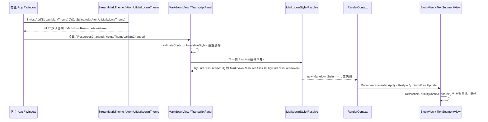

# 主题解析与下发（宿主资源 / `Md.*` → 不可变 `MarkdownStyle` → 每个块视图）

**Trigger:** 控件挂载到可视树（`OnAttachedToVisualTree`）、`ResourcesChanged`、`ActualThemeVariantChanged`（明暗切换），或宿主更换 `MarkdownServices` / `ImageBaseUri`  **Outcome:** 缓存被置空，下一帧由两个持有者之一重新执行 `MarkdownStyle.Resolve(控件)`，得到一份不可变快照并包成新的 `RenderContext`（实例身份即"变了"的信号）下发到每个块视图；没有 `Md.*` 覆盖时字体 / 字号沿用控件继承的 `TextElement` 值，行高是解析后字号的 1.6 倍。

> 本页按 HEAD `8d344a6` 逐条重新核对（此前写作时是 `cd7a2a8`）。相对上一版：`MarkdownStyle` 多了 `Md.SearchHighlightBackground` / `Md.SearchCurrentBackground` 两个 `required` 属性（`required` 从 21 个变成 23 个），但这两个键只做到「常量 + 属性 + 回退值」；`MarkdownView.ApplyLatest` 多了一次 `SetFrameSource`；`DiagramBlockView` 的渲染 key 不再只由语言 / 明暗 / 代码组成；其余步骤的结论未变，行号全部按当前文件重算。

## Steps
1. `src/StreamMark.Avalonia/Themes/StreamMarkTheme.axaml:1` — 默认主题是 `Styles` + `Styles.Resources` + `ThemeDictionaries`：Light（:9）/ Dark（:22）两个主题字典各 11 个 `SolidColorBrush`，主题字典之外 3 个不随明暗变化的键 `Md.MonospaceFontFamily`（:36）、`Md.BlockSpacing`（:37）、`Md.CornerRadius`（:38）；`Md.FontFamily` / `Md.FontSize` / `Md.LineHeight` 故意不设（注释 :4-5）。代码侧以 `x:Class` 编译加载（`Themes/StreamMarkTheme.axaml.cs:11`）。**查找高亮的两个键是仓库内的例外**：`Md.SearchHighlightBackground` / `Md.SearchCurrentBackground` 在字典里没有条目，只有常量 + 属性 + 按 `isDark` 分岔的硬编码回退值（见 `Where to hook in`）(`theme-and-styles`)
2. `README.md:27` — 宿主注册顺序：`Styles.Add(new StreamMarkTheme());` 在前，宿主主题（如 `AtomUIMarkdownTheme`）**必须后加**（Avalonia 资源按后加入者优先）；仓库内示例见 `samples/StreamMark.Gallery/Program.cs:61`，无头测试宿主见 `tests/StreamMark.Avalonia.Tests/HeadlessApp.cs:20`(`theme-and-styles`)
3. `src/StreamMark.Theme.AtomUI/AtomUIMarkdownTheme.cs:AtomUIMarkdownTheme` — 构造函数里 13 次 `Map(key, SharedTokenKind.*)`（:19-31）；`Map`（:34）写的是 `Resources[key] = new MarkdownResourceAlias(token)`，**只登记别名、不解析 token**。`MarkdownResourceAlias` 本身只是 `sealed record(object Key)`（`src/StreamMark.Avalonia/MarkdownResourceAlias.cs:8`），注释说明它"从 Markdown 控件本身开始查找"（:5）。**两个查找高亮键不在映射表里**（:19-31 只有 13 条），所以 AtomUI 宿主下它们仍取 `Resolve` 的回退值(`theme-and-styles`)
4. `src/StreamMark.Avalonia/MarkdownView.cs:MarkdownView`（构造函数 :48）— 挂 `ResourcesChanged += (_, _) => InvalidateContext()`（:66）与 `ActualThemeVariantChanged += (_, _) => InvalidateContext()`（:67）；`MarkdownServices.ServicesProperty` / `ImageBaseUriProperty` 变化的类处理器同样走它（:44、:45）(`avalonia-text-rendering`)
5. `src/StreamMark.Avalonia/MarkdownView.cs:OnAttachedToVisualTree`（:181）— 只做 `Subscribe()`（:188）、`_context = null`（:189）、`RequestFrame()`（:190）；即"挂载即重解析"。`OnSourceChanged`（:103）与 `OnDetachedFromVisualTree`（:193）只改订阅，不改样式(`avalonia-text-rendering`)
6. `src/StreamMark.Avalonia/MarkdownView.cs:InvalidateContext`（:175）— 全部动作只有 `_context = null; RequestFrame();`（:177-178）：**置空缓存**，不直接触碰任何已有块视图(`avalonia-text-rendering`)
7. `src/StreamMark.Avalonia/MarkdownView.cs:RequestFrame`（:142）— `_frameRequested` 合帧（:144-147），`TopLevel.GetTopLevel(this)` 为 null 直接放弃（:149-152），否则 `top.RequestAnimationFrame`（:154）→ 回调 `ApplyLatest`（:157）
8. `src/StreamMark.Avalonia/MarkdownView.cs:ApplyLatest`（:161）— `_context ??= CreateContext()`（:167），随后 `Stream?.SetFrameSource(TopLevel.GetTopLevel(this))`（:168，节奏随显示帧推进）与 `_presenter.Apply(document.Latest, _context)`（:169）；`CreateContext`（:172-173）是唯一的解析点：`new(MarkdownStyle.Resolve(this), MarkdownServices.GetServices(this), Selection, 0, Stream?.State, _state, MarkdownServices.GetImageBaseUri(this))`(`theme-and-styles`)
9. `src/StreamMark.Avalonia/Rendering/MarkdownStyle.cs:MarkdownStyle.Resolve`（:70）— 取 `control.ActualThemeVariant` 与 `isDark`（:72-73），定义局部 `Get<T>(string key, T fallback)`（:74）；每个键先 `control.TryFindResource(key, variant, out var value)`（:76），未命中就 `return fallback`（:78）(`theme-and-styles`)
10. `src/StreamMark.Avalonia/Rendering/MarkdownStyle.cs:MarkdownStyle.Resolve` 内的别名循环（:81）— `for (var depth = 0; value is MarkdownResourceAlias alias && depth < 4; depth++)`，每层都 `control.TryFindResource(alias.Key, variant, out value)`（:83）：**必须从控件本身再查一次**，因为 AtomUI 的 token 注册在窗口 / 主题作用域，而 `Md.*` 字典在自己的位置向上查找看不到它们（`docs/decisions.md:27`）；目标未命中 `return fallback`（:85）(`theme-and-styles`)
11. `src/StreamMark.Avalonia/Rendering/MarkdownStyle.cs:MarkdownStyle.Resolve` 内的类型判定（:88-96）— `value is T typed` 直接返回（:88-91）；`value is Color color && typeof(T) == typeof(IBrush)` 时转 `new ImmutableSolidColorBrush(color)`（:92-95）；其余一律 `return fallback`（:96）(`theme-and-styles`)
12. `src/StreamMark.Avalonia/Rendering/MarkdownStyle.cs:MarkdownStyle.Resolve` 内的一次性读取（:99-128）— 先解析 `foreground`（:99）与 `secondary`（:100），再用它们当默认值：`InlineCodeForeground` = `foreground`（:108）、`ListMarkerForeground` = `secondary`（:109）；字体 / 字号缺省时取控件继承值 `control.GetValue(TextElement.FontSizeProperty)`（:102）与 `TextElement.FontFamilyProperty`（:103，注释 :101）；等宽字体回退 `"Menlo, Consolas, monospace"`（:123）；**`LineHeight` 用的是解析后的 `fontSize`**：`Get<double>(Md.LineHeight, Math.Round(fontSize * 1.6))`（:125）；`BlockSpacing` 缺省 12（:126）、`CornerRadius` 缺省 `new CornerRadius(6)`（:127）、`IsDark = isDark`（:128）；`MarkBackground`（:110）与两个查找高亮色（:111、:112）的默认值是每次解析新建的画刷，且按 `isDark` 分岔(`theme-and-styles`)
13. `src/StreamMark.Avalonia/Rendering/MarkdownStyle.cs:MarkdownStyle`（:15）— 对象是**不可变快照**：23 个 `required … { get; init; }` 属性（:17-41），`CodeFontSize`（:43）/ `CodeLineHeight`（:45）/ `HighlightTheme`（:47）/ `HeadingFontSize`（:50）/ `AlertBrush`（:60）都是现算，没有 setter，所以"改样式"只能靠重建实例(`theme-and-styles`)
14. `src/StreamMark.Avalonia/Rendering/RenderContext.cs:RenderContext`（:14）— 快照被装进上下文：`Style = style`（:18），`Style` 为只读属性（:25）；`With(...)`（:52）与 `WithHtml(...)`（:60）每次都 `new` 一个实例并沿用同一个 `Style` 引用。因此**上下文实例身份就是"样式变了没"的唯一信号**（类注释 :8-11）(`theme-and-styles`, `avalonia-text-rendering`)
15. `src/StreamMark.Avalonia/Rendering/DocumentPresenter.cs:DocumentPresenter.Apply`（:30）— `var contextChanged = !ReferenceEquals(Context, context)`（:32）；差异回放里 `Insert` 走 `BlockViewFactory.Create` + `view.Update`（:41-45），`Update` 先问 `BlockViewFactory.CanReuse`（:51）(`avalonia-text-rendering`, `avalonia-plugin-system`)
16. `src/StreamMark.Avalonia/Rendering/DocumentPresenter.cs:Restyle`（:83）— `contextChanged` 为真时按原模型全量重应用所有视图（:73-76、:85-99），视图类型可能因此替换（新上下文下 `ViewTypeFor` 的结果会变，例如 `BlockViewFactory.cs:95` 只在代码块闭合且存在图表渲染器时给 `ViewType.Diagram`）(`avalonia-text-rendering`)
17. `src/StreamMark.Avalonia/Rendering/BlockView.cs:BlockView.Update`（:25）— 每个块视图自己再判一次 `contextChanged = !ReferenceEquals(Context, context)`（:27）并把结果传进 `OnUpdate(...)`（:32）；容器视图 `StackBlockView.UpdateChildren`（:77）按位置 `CanReuse` 复用子视图或替换（`BlockViewFactory.CanReuse`，`BlockViewFactory.cs:40`）(`avalonia-text-rendering`)
18. 解析结果只被两处持有（无跨进程 / 跨线程边界，全流程都在界面线程上）：`MarkdownView._context`（`MarkdownView.cs:34`，赋值点 `:167`）与 `TranscriptPanel._style`（`TranscriptPanel.cs:75`，赋值点 `:361`、`:534`、`:872`）。全仓库 `MarkdownStyle.Resolve` 的调用点只有 `MarkdownView.cs:173`、`TranscriptPanel.cs:361`、`:534`、`:872` 与两个测试（`tests/StreamMark.Avalonia.Tests/Rendering/StyleKeysTests.cs:20`、`:34`）(`theme-and-styles`, `avalonia-transcript`)
19. `src/StreamMark.Avalonia/Rendering/TextSegmentView.cs:TextSegmentView.Set`（:129）— 变化判定包含 `!ReferenceEquals(_context, context)`（:166）；`appendOnly` 只在上下文引用未变时才允许走增量路径（:189），差异点 `FirstDifference`（:190）→ `_runCache.InvalidateFrom(段落起点)`（:201-202）；上下文变了必然 `from = 0`（:190、:192-196）→ 全文重排(`avalonia-text-rendering`)
20. `src/StreamMark.Avalonia/Rendering/TextSegmentView.cs:TextSegmentView.EnsureLayout`（:319）— 行高按字号比例取快照值：`lineHeight: _context.Style.LineHeight * (_fontSize / _context.Style.FontSize)`（:346）；`Style.Foreground` 是默认前景（:344）；HTML 盒子里的绝对字号按 `context.Style.FontSize` 缩放（`Set`，:150-153）。所以宿主改窗口字号会连带改行高。逐行排版本身由 `SegmentLayout` 承担（`Rendering/SegmentLayout.cs:17`，`Format` :57；两端对齐整段交给 `TextLayout`）(`avalonia-text-rendering`)
21. `src/StreamMark.Avalonia/Transcript/TranscriptPanel.cs:TranscriptPanel`（构造函数 :209）— 同样挂 `ResourcesChanged`（:219）与 `ActualThemeVariantChanged`（:220）→ `InvalidateStyle`；静态构造函数挂 `MarkdownServices.ServicesProperty`（:225）；`OnAttachedToVisualTree` 也调它（:1013-1016）(`avalonia-transcript`)
22. `src/StreamMark.Avalonia/Transcript/TranscriptPanel.cs:InvalidateStyle`（:348）— `_style = null`（:350）并对**每个 entry** `entry.Context = null`（:351-354），然后 `RequestFrame()` + `InvalidateMeasure()`（:355-356）；序号变化时也逐条置空（`SyncEntries`，:281、:321-325）(`avalonia-transcript`)
23. `src/StreamMark.Avalonia/Transcript/TranscriptPanel.cs:ContextFor`（:359）— `_style ??= MarkdownStyle.Resolve(this)`（:361，**解析对象是面板自己**），Services 每次现取（:362），任一身份不等（`state.Context is null || !ReferenceEquals(state.Context.Style, _style) || !ReferenceEquals(state.Context.Services, _services) || ImageBaseUri 不等`，:363-364）就重建该条目的 `RenderContext`（:367）(`avalonia-transcript`)
24. `src/StreamMark.Avalonia/Transcript/TranscriptPanel.cs:MeasureOverride`（:858）— 排版兜底路径也解析一次：`_style ??= MarkdownStyle.Resolve(this)`（:872）；未测量行的高度估算同样用快照（`Estimate(MarkdownBlock)`，:702；`EstimateText`，:532-534，`charsPerLine = width / (style.FontSize * 0.62)`），行间距用 `_style?.BlockSpacing ?? 12`（`EnsureTops`，:770）(`avalonia-transcript`)
25. `src/StreamMark.Avalonia/Transcript/TranscriptPanel.cs:ApplyAll`（:379）— 每次 `ApplyLatest` 逐条目 `ContextFor(i, state)`（:390）；快照没变但上下文变了时走 `RefreshRealizedContexts`（:624）：逐行 `ViewContext(view)`（= `view.CurrentContext`，:635）与当前上下文比引用，不等则 `UpdateView`（:630）；新实例化的行在 `Realize`（:807）里 `ContextFor`（:821）+ `BlockView.Update`（:825）(`avalonia-transcript`)
26. `src/StreamMark.Avalonia/Rendering/CodeBlockState.cs:CodeBlockState.For`（:48）— 快照的明暗经 `context.Style.HighlightTheme`（:51，`MarkdownStyle.cs:47` 的 `IsDark ? Dark : Light`）进入高亮状态；语言 / 高亮器 / 主题任一变化就 `Dispose` 旧状态并重建（:53-59），新主题在 `CreateSession(Language, Theme)`（:104）上生效。⇢ 同样进入 TextMate 主题：`src/StreamMark.Highlighting.TextMate/TextMateSyntaxHighlighter.cs:TextMateSyntaxHighlighter.GetContext`（:148）按 `HighlightThemeKind` 选 `ThemeContext`（`ThemeContext.cs:31`）(`avalonia-plugin-system`, `theme-and-styles`)
27. `src/StreamMark.Avalonia/Rendering/DiffBlockView.cs:DiffHighlightState.For`（:949）— diff 视图把明暗以同样方式记进自己的高亮状态：`var theme = context.Style.HighlightTheme`（:952），与已有状态不一致就重建（:954-960）(`avalonia-text-rendering`)
28. `src/StreamMark.Avalonia/Rendering/DiagramBlockView.cs:DiagramBlockView.OnUpdate`（:71）— 走 `Refresh`（:95）：先由 `ResolveEnvironment(context.Style)`（:124）把快照折成渲染环境——底色是 `CodeBackground` 叠到祖先的不透明底色上（`BackdropColor(style.IsDark)`，:126、:140），前景 / 强调色再经 `DiagramRenderContext.Flatten` 叠到该底色（:129-131，不透明色）；渲染 key 由 `RenderKey(code, environment, renderer)` 组成（:117-118，含渲染器哈希、语言、明暗、前景 / 背景 / 强调色、字体名与字号、代码），key 变了才 `StartRender`（:103-106、:190），结果按 key 进 32 项 `DiagramCache`（:371-373）；`Renderer.RenderAsync` 在 `Task.Run` 里执行（:213），回投 `Dispatcher.UIThread.InvokeAsync`（:233）并校验 key（:239）(`avalonia-plugin-system`, `theme-and-styles`)
29. `src/StreamMark.Avalonia/Rendering/TextSegmentView.cs:InlineTextSource.GetTextRun`（:972）— 行内组件绘制对象在 `CreateObjectRun`（:1167）里拿的是 `new Plugins.InlineComponentContext(style, _fontSize, _foreground, properties, _maxWidth)`（:1198-1200），其中 `style` 就是快照；成对组件的样式覆盖也直接吃快照：`GetStyle(..., MarkdownStyle style)`（`Plugins/IMarkdownPlugin.cs:111`、`:124`，实现见 `Plugins/BuiltInComponentsPlugin.cs:246`）(`avalonia-plugin-system`)

## Sequence

## Errors and cancellation
- 键名写错或从未被任何字典定义：`control.TryFindResource(key, variant, out var value)` 返回 false → 直接 `return fallback`（`MarkdownStyle.cs:76-78`）。**不抛异常、不写日志**，表现为"宿主覆盖了但看起来没换肤"。`Md.SearchHighlightBackground` / `Md.SearchCurrentBackground` 就落在这一支（默认字典里没有条目），只有宿主自己设置同名资源时才会命中。
- 别名目标键找不到：同一处循环里 `return fallback`（`MarkdownStyle.cs:83-86`），效果与上一条相同。
- 别名链超过 4 层：`depth < 4` 使循环退出时 `value` 仍是 `MarkdownResourceAlias`，`value is T typed` 不成立 → `return fallback`（`MarkdownStyle.cs:81`、`:96`）。同样静默。
- 类型不符：例如目标值是 `string`、或值类型与取值处的 `T` 不一致（`CornerRadius` / `double` / `FontFamily` 都不走 `Color` 转换，只有 `Get<IBrush>` 时才转，`MarkdownStyle.cs:92`）→ `is T` 失败 → `fallback`（:88-96）。
- 没有取消令牌，也没有异常路径：一次 `ApplyLatest` 里 `Resolve` 只跑一次、纯同步读资源。帧请求靠 `_frameRequested` 合帧（`MarkdownView.cs:144`、`TranscriptPanel.cs:336`）；`TopLevel.GetTopLevel(this)` 为 null 时请求被丢弃（`MarkdownView.cs:149-152`），控件脱离可视树后的那次刷新会顺延到下次挂载时的置空 + 请求（`MarkdownView.cs:189-190`、`TranscriptPanel.cs:1013-1016`）——这一条只在代码上读到，未做运行验证 (unverified)。
- 宿主"改了资源但没生效"的常见原因：只有在触发 `ResourcesChanged` / `ActualThemeVariantChanged` 时才会置空重解析（`MarkdownView.cs:66-67`、`TranscriptPanel.cs:219-220`）；直接把资源写在 Markdown 控件所在作用域之外、又没有一次这两个事件，就不会重新解析。

## Where to hook in
- 新增一个 `Md.*` 键必须同步的位置（缺一处就有对应症状）：`MarkdownResourceKeys` 加常量（`MarkdownResourceKeys.cs:9-35`）→ `MarkdownStyle` 加 `required` 属性（`MarkdownStyle.cs:17-41`）并在 `Resolve` 的初始化器里 `Get<T>(键, 默认值)`（:104-128，漏了属性会直接编译失败）→ 在 `src/StreamMark.Avalonia/Rendering/**` 真的读它 → 默认值写进 `StreamMarkTheme.axaml` 的 Light（:9）/ Dark（:22）字典或主题字典之外（:36-38）→ 可选地在 `AtomUIMarkdownTheme.Map`（:19-31）指向 AtomUI token → 测试 `StyleKeysTests`（`tests/StreamMark.Avalonia.Tests/Rendering/StyleKeysTests.cs:12`）。
  - **本仓库的例外**：`Md.SearchHighlightBackground` / `Md.SearchCurrentBackground` 只做了「常量（`MarkdownResourceKeys.cs:28`、`:30`）+ `required` 属性（`MarkdownStyle.cs:28`、`:30`）+ `Resolve` 里的回退值（`MarkdownStyle.cs:111-112`，按 `isDark` 分岔）」三步：`Themes/StreamMarkTheme.axaml` 的两个主题字典里没有条目，`AtomUIMarkdownTheme.Map`（:19-31）也没有映射，所以它们**不跟随任何宿主 token**，宿主只能自己设同名资源才覆盖得到。消费点是三处 `Render`（`TextSegmentView.cs:577`、`CodeBlockView.cs:651`、`DiffBlockView.cs:823`），`README.md:101` 点名了这两个键。
- 新增整套主题：继承 `Styles`，按 `Styles.Add(new StreamMarkTheme()); Styles.Add(new MyTheme());` 的顺序**后加**（`README.md:27-28`）；XAML 主题沿用 `x:Class` + `AvaloniaXamlLoader.Load`（`Themes/StreamMarkTheme.axaml.cs:11`）。
- 宿主换主题的推荐方式：换 `ThemeVariant`（走 `ActualThemeVariantChanged`）或替换原子级 `Md.*` 资源（走 `ResourcesChanged`）；像 AtomUI 这种"token 在窗口 / 主题作用域"的宿主不要写 `DynamicResource` 画刷，而应写 `MarkdownResourceAlias`（`docs/decisions.md:27`，实现见 `MarkdownStyle.cs:81`、`MarkdownResourceAlias.cs:5`、`:8`）。
- 会破坏下发的改动：
  - 原地修改已有 `MarkdownStyle` 实例（属性全是 `get; init;`，`MarkdownStyle.cs:17`）或在视图里绕过快照直接查资源：身份不变则 `DocumentPresenter.cs:32`、`BlockView.cs:27`、`TextSegmentView.cs:166` 都不会重排重绘。
  - 给 `MarkdownStyle.Resolve` 的结果再加一层长生命周期缓存，或复用旧实例：`MarkdownView.cs:175` 与 `TranscriptPanel.cs:348` 依赖"置空 → 下一次新建"这条链。
  - 在 `InvalidateContext` / `InvalidateStyle` 里同步直接改块视图的属性：会绕过 `Restyle`（`DocumentPresenter.cs:83`）与 `BlockViewFactory.CanReuse`（`BlockViewFactory.cs:40`）的视图替换判定。
  - 改动 `RenderContext.With` / `WithHtml`（`RenderContext.cs:52`、`:60`）时丢掉 `Style` 引用透传：每个 HTML 盒子都会让文本片段上下文变化，触发整块重排。
  - 往宿主资源里写 `Color` 却把取值处的 `T` 取成非 `IBrush`：不会走 `MarkdownStyle.cs:92` 的转换，直接回落。
  - 给 `TranscriptPanel` 之外再加一个持有 `_style` 的地方（如静态缓存）：当前 `_style`（`TranscriptPanel.cs:75`）与 `MarkdownView._context`（`MarkdownView.cs:34`）是仅有的两个持有者，多一处就不会随 `InvalidateStyle` 一起失效。

## Related
- Modules: [theme-and-styles](../modules/theme-and-styles.md)
- Modules: [avalonia-text-rendering](../modules/avalonia-text-rendering.md)
- Modules: [avalonia-transcript](../modules/avalonia-transcript.md)
- Modules: [avalonia-plugin-system](../modules/avalonia-plugin-system.md)
- Flows: [streaming-token-to-view](streaming-token-to-view.md)
