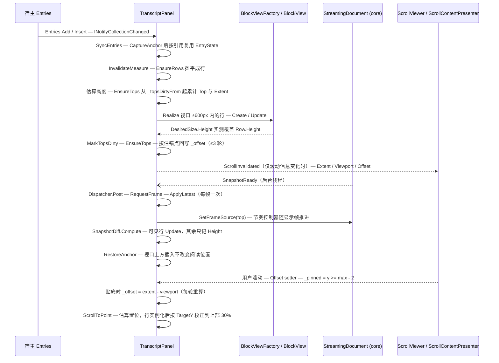

# 会话面板的虚拟化与滚动（行模型 → 视口窗口 → 锚定 → 贴底）

**Trigger:** 宿主向 `TranscriptView.Entries` 添加 / 插入 / 移除条目（宿主内容 `ContentEntry`、Markdown 消息 `MarkdownEntry`、延迟解析条目 `FromTextDeferred`），或某条消息的 `StreamingDocument` 产生新快照（`SnapshotReady`），或用户滚动 / 改变窗口宽度，或宿主调用 `ScrollToPoint`（查找、目录、文内锚点跳转）  **Outcome:** 只为视口 ±600px 内的行实例化 `BlockView`，其余行只以估算或上次实测的高度参与 `Extent`；追加与视口上方插入不改变用户当前阅读位置（视口内首行相对位置不变）；贴底时 `Offset` 恒等于 `extent - viewport` 并跟随最新内容，用户向上滚动即解除；被回收的行仍可被选中复制。行高变化后 `Top` 与 `Extent` **从第一处变化的行起增量重算**（`_topsDirtyFrom`），不再每次全量扫描；`ScrollToPoint` 先按估算置位、等目标行实例化后再按字符实际位置校正到视口上部约 30%。

> 工作区状态：本页按 HEAD `8d344a6` 重写并逐条与源码核对。`cd7a2a8..8d344a6` 之间本流程改动很大：`074f7ff`（导航 / 查找 / 键盘选区 / 右键菜单 / 无障碍）给面板加了 `ScrollToPoint` / `RowFor` / `TargetY` / `GetOutline` / `OnLinkClicked` / `Search` / `MarkdownContextMenu`；`8265089`（流式 CPU：逐行排版 + 渲染线程末尾渐显）给 `MarkdownEntry` 加了 `Stream` 并把 `MarkdownStream.SetFrameSource` 交给面板；`a106aae` / `2804f5b` / `f36d637` / `ebe7118` / `5fe2de1` / `3b192e6` 是图像、mermaid、内存与测试改动，`DiffBlockView` 在 `a72b840` 起是 `diff` / `patch` 围栏的默认呈现。核对时工作树里本页与其它 `.agents/codemap/` 页面都有未提交改动（本页即这次重写，`flows/text-selection-copy.md` 在同一次改动里一并重写）；下面所有行号取自 `8d344a6` 的源码。

## Steps

1. `src/StreamMark.Avalonia/Transcript/TranscriptView.cs:TranscriptView`（构造函数 :15-22）— 构造时 `Panel = new TranscriptPanel()`、`Panel.SetEntries(Entries)`、`Content = Panel`（:17-19），禁用横向滚动条、纵向 `Auto`（:20-21），`StyleKeyOverride` 沿用宿主主题里的 `ScrollViewer` 模板（:24），所以面板只是 `ScrollViewer.Content`；新增的对外成员全部转调面板：`Search`（:35，惰性 `SearchModel`）、`GetOutline()`（:38）、`ScrollToPoint`（:41）、`IsPinnedToBottom`（:43）、`ScrollToEnd`（:46）、`MaxContentWidth` / `EntrySpacing`（:49 / :55）(`avalonia-transcript`)
2. `src/StreamMark.Avalonia/Transcript/TranscriptPanel.cs:TranscriptPanel.SetEntries`（:263）— 把宿主集合按 `IReadOnlyList` 存下并退订 / 订阅 `INotifyCollectionChanged`（:265-274），随后 `SyncEntries()`（:275）；之后宿主的每次 `Add` / `Insert(0, …)` / `Remove` 都走 `OnCollectionChanged`（:278）(`avalonia-transcript`)
3. `TranscriptPanel.SyncEntries`（:281）— **先** `CaptureAnchor()`（:283）**再**重建 `_entries`：用 `Dictionary<TranscriptEntry, EntryState>` 按**引用**复用旧状态（`existing.Remove(entry, out state)`，:284-301），新 `MarkdownEntry` 订阅 `Document.SnapshotReady`（:295-298）；被移除的条目退订、`Unrealize` 它的所有行、移除内容控件（:302-316）；随后把 `Context = null` 的判定放在序号变化的条目上（:320-326，`RenderContext.Entry` 是选区坐标第一维）；末尾 `_rowsDirty = true` + `RequestFrame()` + `InvalidateMeasure()`（:327-329）(`avalonia-transcript`)
4. `TranscriptPanel.EnsureRows`（:724）— 摊平：对每个 `EntryState` 把 `state.Rows` 追加进 `_rows`（:730-747）。Markdown 消息的行不是在 `EnsureRows` 里建的，而是在 `ApplyAll` 里按 `SnapshotDiff` 的 `Insert` / `Update` / `Remove` 增删（:413-451），所以**每个 Markdown 顶层块至少一行**、`EntryState.Slots` 逐块记录占了几行（:431 / :446 / :586）；`ContentEntry` 恒一行、初始高度固定 60（:734-740）；未解析的延迟条目是一行占位行（`Row.Block == null`，高度 `EstimateText(DeferredText)`，:741-745）。末尾刷新每个 `Row.Index`（:748-751，`MarkTopsDirty` 靠它判断能否增量）、清 `_rowsDirty`、`MarkTopsDirty(null)` 强制全量重算 `Top`（:752-753）(`avalonia-transcript`)
5. `TranscriptPanel.ChunkCount`（:642）— 超长代码块分段：行数 `> ChunkThresholdLines = 200`（:638）时按 `LinesPerChunk = 128`（:640）拆成 `(lines + 127) / 128` 行（:649-657）；折叠的代码块（`CodeBlockView.ShouldCollapse`，:645）不分段；`Realize` / `UpdateView` 时经 `ApplyChunk`（:660-666）调 `CodeBlockView.SetChunk(chunk, count, LinesPerChunk)`，让该段只排版自己的行窗口（`Rendering/CodeBlockView.cs:94`）(`avalonia-transcript`、`avalonia-text-rendering`)
6. `TranscriptPanel.Estimate`（两个重载，:689 / :702）+ `EstimateText`（:532）— 估算只对"从未进过视口"的行存在：按块类型给初始高度（`ParagraphBlock` = 行数 × `LineHeight`、`CodeBlock` = 行数 × `CodeLineHeight` + 48、`ThematicBreakBlock` = 17、`_` = `LineHeight × 2`，:708-721），每行字符数按 `width / (FontSize × 0.62)` 估（:706），`_width` 还是 `NaN` 时兜底 **720**（:705，`_width` 初值见 :77）；分段行单独走 `Estimate(Row, …)`，把代码块头部 34 / 底部 14 加到首段与末段（:691-695，常量定义 `Rendering/CodeBlockView.cs:24-25`）；延迟条目的占位行按换行与空行累加（`EstimateText`，含 `BlockSpacing` 合并连续空行，:535-553）(`avalonia-transcript`、`avalonia-text-rendering`)
7. `TranscriptPanel.EnsureTops`（:764）+ `MarkTopsDirty`（:757）— **增量**累加 `Row.Top` 与总高度：`MarkTopsDirty(row)` 只把 `_topsDirtyFrom` 压到该行的 `Index`（行结构已变 / `_rowsDirty` / `Index` 过期时退回 0，:759-761），`EnsureTops` 从 `_topsDirtyFrom` 起算，起点 y 取上一行的 `Top + Height`（:771-772），逐行相加：同一代码块的分段相接（间距 0）、同一消息的块之间 `BlockSpacing`、跨消息 `EntrySpacing`（默认 24，:242；:778-779），算完写 `_extent = (宽度, y)` 并清 `_topsDirty`（:784-785）；样式未解析时间距兜底 12（:770）；`_style` 解析自 `MarkdownStyle.Resolve`（:872，默认 `BlockSpacing = 12`、`LineHeight = round(fontSize × 1.6)`，`Rendering/MarkdownStyle.cs:125-126`）。流式时每帧只有末尾几行变化，因此是 O(变化行之后的行数) 而不是 O(行数)(`avalonia-transcript`、`avalonia-text-rendering`)
8. `TranscriptPanel.MeasureOverride`（:858）— 一次测量内按序串起整条链：宽度变化检查（:863-871）→ `EnsureRows()`（:873）→ `EnsureTops()`（:874）→ `RestoreAnchor()`（:875）→ `ParseVisibleDeferred(height)`（:876）→ 记下"视口内首行 + 相对视口位置"（:879-881）→ `RunPasses(anchor, anchorDelta)`：3 轮实例化 / 测量（:883-944）→ `_scrollTarget` 的字符级精定位（:946-955）→ 夹 `Offset`、写 `_viewport` / `_extent`（:957-960）→ `UpdateTail()`（:961）→ 只在滚动信息变化时触发 `ScrollInvalidated`（:962-968）(`avalonia-transcript`)
9. `TranscriptPanel.ParseVisibleDeferred`（:503）— 在视口窗内（贴底时用 `max(0, _extent.Height - height)` 当作 `offset`，:507）扫到 `Row.Block == null` 且 `Owner.Entry is MarkdownEntry { IsParsed: false }` 的行就 `CaptureAnchor()` + `EnsureParsed()`（:511-519），然后 `ApplyAll` + `EnsureRows` + `EnsureTops` + `RestoreAnchor`，最多 **8 轮**（:505 / :524-527）；`EnsureParsed` 用 `Interlocked.Exchange` 保证只解析一次（`Transcript/TranscriptEntry.cs:52-58`），解析走界面线程同步的 `StreamingDocument.LoadNow`（`src/StreamMark.Core/Streaming/StreamingDocument.cs:126`）(`avalonia-transcript`、`core-streaming`)
10. ⇢ crosses **thread** boundary via `StreamingDocument.SnapshotReady`（`Action<DocumentSnapshot>`，在**后台线程**触发，契约要求处理函数尽快返回）(`core-streaming`；`StreamingDocument.cs:49-50`，发布点 `:231`（后台 `Run`）与 `:150`（`LoadNow` 同步解析））
11. `TranscriptPanel.OnSnapshotReady`（:332）→ `RequestFrame`（:334）→ `TopLevel.RequestAnimationFrame` — 事件处理只做 `Dispatcher.UIThread.Post(RequestFrame, DispatcherPriority.Render)`（:332）；`RequestFrame` 用 `_frameRequested` 合帧，每帧最多一次，帧回调里调 `ApplyLatest()`（:373-377 → `ApplyAll` + `InvalidateMeasure`）(`avalonia-transcript`)
12. `TranscriptPanel.ApplyAll`（:379）— 遍历所有条目：未解析 / 非 Markdown 条目直接跳过（:385-388）；**先把显示帧来源交给节奏控制器** `markdown.Stream?.SetFrameSource(top)`（:389，`top` 在 :381 取一次，`SetFrameSource` 是 `internal`，见 `src/StreamMark.Avalonia/MarkdownStream.cs:48`）；`latest` 与 `state.Applied` 同一对象、本次 `ContextFor` 结果与 `state.RefreshedContext` 同一对象、且首行有块时整条跳过（:392-395）；占位行刚解析完时先 `CaptureAnchor()` 清空该条目的行与 `Slots`、把 `Applied` 置回 null 以触发全量重建（:396-404）；`contextChanged` 为假且快照同一对象时走 `RefreshRealizedContexts` 快路径并记下 `RefreshedContext`（:405-411）；否则 `CaptureAnchor()` + `foreach (var op in SnapshotDiff.Compute(state.Applied, latest))`，按 `op.Index` 前累加 `Slots` 得到 `rowStart`（:412-419）(`avalonia-transcript`、`core-streaming`)
13. `src/StreamMark.Core/Streaming/SnapshotDiff.cs:SnapshotDiff.Compute`（:24）— 差异语义：同代且共享冻结列表时从 `min(previous.FrozenCount, next.FrozenCount)` 起比（:28），按 `Key`（= 块源码起点）归并，同 key 且类型 / `Range` / `ComputeFingerprint()` 有变化才发 `Update`（:35-45）；`DiffOp.Index` 是"正在变换的列表"中的位置（:12-16）(`core-streaming`、`core-parsing-and-model`)
14. `TranscriptPanel.ApplyAll` 的三支（:420-450）— `Insert`：按 `ChunkCount` 建 `count` 个 `Row`（高度取 `Estimate`）、插入 `op.Index` 对应的行位并写 `Slots`（:422-434）；`Update` → `UpdateBlockRows`（:435-437）；`Remove`：先 `Unrealize` 再删掉该块占的所有行（:438-449）；`Insert` / `Remove` 置 `_rowsDirty`（:432 / :447），行结构未变时由 `UpdateBlockRows` 的 `MarkTopsDirty` 接住增量重算(`avalonia-transcript`)
15. `TranscriptPanel.UpdateBlockRows`（:557）/ `UpdateView`（:668）— **差异只更新可见行，可见行之外只记账**：只有 `updated.View is BlockView`（即当前已实例化）的行才 `view.Update(context, …)`，其余行只重算 `updated.Height = Estimate(updated, context)`（:570-585）；`UpdateView` 用 `BlockViewFactory.CanReuse` 决定原地更新还是替换视图（:671-684，`Rendering/BlockViewFactory.cs:40`），两条路径末尾都 `MarkTopsDirty(row)`（:686）；块状态（代码块展开 / 折叠、换行、diff 显示方式）随 `EntryState.State`（`Plugins/BlockStateStore`）跨行增删与视图回收存活（:41）(`avalonia-transcript`、`avalonia-text-rendering`)
16. `TranscriptPanel.MeasureOverride` 的实例化窗口（`RunPasses`，:883）— `Overscan = 600`（:59）；每轮按 `top = max(0, offset - 600)`、`bottom = offset + height + 600` 取行区间（`FirstRowAt` 二分，:788-805 / :891-896），对区间内每行 `Realize` 后 `view.Measure(new Size(width, ∞))`，再把 `view.DesiredSize.Height` 与 `row.Height` 比较，差 > 0.5 就改写（:905-917）；`_realized` 里本轮没被保留的行 `Unrealize`（:919-930，复用 `_keep` / `_unrealize` 两个集合避免每轮分配）；只要高度有变化就 `MarkTopsDirty(changed)` + `EnsureTops()`（:935-936），并（非贴底且锚点还在）保持视口首行位置（:937-940），最多 **3 轮**（:885），无变化即提前跳出（:931-934）(`avalonia-transcript`、`avalonia-text-rendering`)
17. `TranscriptPanel.Realize`（:807）/ `Unrealize`（:846）/ `BuildContent`（:834）/ `ArrangeOverride`（:972）— 实例化：`ContentEntry` 用缓存的内容控件或 `FindDataTemplate` / `TextBlock` 兜底（:815-818 / :834-844），Markdown 行走 `BlockViewFactory.Create` + `ApplyChunk` + `Update` 并 `Children.Add`，行加入 `_realized`（:819-831）；回收：`Children.Remove` 后块视图直接丢弃（`row.View = null`），宿主内容控件留在 `EntryState.ContentView` 以便再次出现时复用（保住其内部状态）（:846-856）；排列按 `row.Top - _offset.Y` 定位、内容列按 `MaxContentWidth` 居中（:972-981）(`avalonia-transcript`、`avalonia-text-rendering`)
18. `TranscriptPanel.Extent` / `Viewport` / `Offset`（`ILogicalScrollable`，:1028-1062）— 面板自算的滚动几何：`Extent` / `Viewport` 在测量末尾写入（`_viewport = (fullWidth, height)`，:959；`_extent` 宽度取完整可用宽度、高度不变，:960），`ScrollSize = (0, 48)`（每行 48px 的键盘 / 滚轮步长，:1034）、`PageScrollSize = (0, max(48, viewport.Height - 48))`（:1036）；`ScrollInvalidated` 只在 `(extent, viewport, offset)` 与 `_lastScrollInfo` 不同时触发（:962-968，流式时每帧都会测量），`SetOffsetInternal`（:1095-1111）在 `_settingOffset` 保护下另发一次(`avalonia-transcript`)
19. `Avalonia.Controls.Presenters.ScrollContentPresenter`（12.1.3，非本仓库代码）— `TranscriptView` 的模板把本面板当 `Child`，presenter 订阅 `ScrollInvalidated` 并在回调里 `Viewport = scrollable.Viewport; Extent = scrollable.Extent; SetCurrentValue(OffsetProperty, scrollable.Offset)`，反向把 `ScrollViewer.Offset` 的变化写回 `scrollable.Offset`（Avalonia 12.1.3 `ScrollContentPresenter.UpdateScrollableSubscription` / `UpdateFromScrollable`，随包版本走，本仓库未固定源码路径：(unverified))；这就是"用户滚轮 / 拖动滚动条 → 面板 `Offset` setter"的通道（`avalonia-transcript`）
20. `TranscriptPanel.CaptureAnchor`（:463）/ `RestoreAnchor`（:480）/ `PendingAnchor`（:89）— 视口上方插入的锚定：`CaptureAnchor` 在 `_pendingAnchor` 已有值、**贴底**或 `_rows` 为空时提前返回（:465，所以贴底期间不记锚点），否则 `EnsureTops` 后取 `FirstRowAt(_offset.Y)` 的行，记下 `(行, 行顶 - offset, 所属条目顶 - offset)`（:469-477）；恢复时若该行还在原条目里就 `_offset = 行顶 - delta`（:491-494），若该行已被替换（延迟条目占位行展开成真实行）就改用**条目顶部**（:495-499），贴底或条目已被移出 `_entries` 则丢弃（:486-490）；用户直接改 `Offset` 或经 `SetOffsetInternal` 时清空 `_pendingAnchor`（:1059 / :1100）(`avalonia-transcript`)
21. `TranscriptPanel.CaptureAnchor` 的调用点 + 测量末尾的锚点回写 — `SyncEntries`（:283）、`ApplyAll`（:399 / :412）、`ParseVisibleDeferred`（:515）、代码块展开 / 折叠（:612）都会在改动行结构**之前**记锚点；测量里 `anchor` 是"本轮开始时的视口首行 + delta"（:879-881），高度变化后由 `RunPasses` 回写 `_offset = anchor.Top - anchorDelta`（:937-940）；该回写只改 `_offset` 而不改 `_pinned`，所以贴底期间由 :887-890 的分支接管（`TranscriptPanel.CaptureAnchor` / `RestoreAnchor`）(`avalonia-transcript`)
22. `TranscriptPanel.MeasureOverride` 的贴底分支（:887-890）— 贴底时**每一轮**都把 `_offset` 直接置为 `max(0, _extent.Height - height)`，所以新内容（或实测行高变大）到达时视口自动跟到底部；`_pinned` 初值 `true`（:81，新面板一开始就贴底），`ScrollToEnd()` 只置位 + `InvalidateMeasure()`（:1020-1024）(`avalonia-transcript`)
23. `TranscriptPanel.Offset` setter（:1042）— 用户滚动的反馈：把 `y` 夹到 `[0, max(0, extent.Height - viewport.Height)]`（:1051-1052），与当前值差 `< 0.01` 直接返回（:1053-1056），否则写 `_offset`、**`_pinned = y >= max - 2`**（滚离底部即解除贴底、滚回底部 2px 内自动恢复，:1057-1058）、`_pendingAnchor = null`、`InvalidateMeasure()`（:1059-1060）；`_settingOffset` 期间忽略回写以防 `ScrollInvalidated` 递归（:1047-1050 / :1102-1110）；`BringIntoView` 只在**已实例化**的行里找目标控件并滚动，未命中返回 false（:1066-1089），`GetControlInDirection` 恒 `null`（无键盘逐行导航，:1091）(`avalonia-transcript`)
24. `TranscriptPanel.MeasureOverride` 的宽度变化处理（:863-871）— `width`（= `min(可用宽度, MaxContentWidth)`，:860-861）与 `_width` 不等时把**所有** `Row.Measured` 置 false 并 `MarkTopsDirty(null)`（:863-871）——行高作废但不立即重算，只有行再次进入 ±600 窗口时才重新测量，所以宽度变化后 `Extent` 是逐步收敛的；`MaxContentWidth` 只影响内容列宽度与排列的居中 `x`（:974-975），`Extent.Width` 始终是完整可用宽度（:960）(`avalonia-transcript`、`avalonia-text-rendering`)
25. ⇢ crosses **thread** boundary (I/O → UI) via `ImageSlot.Load` 的 `Dispatcher.UIThread.InvokeAsync` — 视口内某行的图片加载完成后 `TextSegmentView.OnResourceLoaded`（`Rendering/TextSegmentView.cs:433-440`，作废 run 缓存 + `InvalidateLayout`）→ 下一轮 `MeasureOverride` 把新的 `DesiredSize.Height` 写进 `Row.Height`（:912-917）并 `MarkTopsDirty` / `EnsureTops`，该行与后续行位置随之修正（`Rendering/ImageSlot.cs:88-98` 回投）(`avalonia-images`、`avalonia-text-rendering`)
26. `TranscriptPanel`（`ISelectionHost`，:1124-1163）— **被回收到内存之外的行仍可复制**：`RealizedSegments()` 只枚举 `_rows` 中已实例化的 `BlockView`（命中测试用，:1126-1127），但 `GetSnapshot(entry)` 返回与视图无关的 `state.Applied`（:1147），`GetSource` 从 `StreamingDocument.GetText` 取源码（:1150-1151）；跨到尚未解析的条目时 `EnsureParsed()` + `RequestFrame()` 后返回刚同步产出的 `Document.Latest`（:1140-1146）；拖拽超出视口时 `OnSelectionDrag`（:1153-1163）每帧最多 ±40px 自动滚动，`SelectionController.GetSelectedText` 因此遍历快照的 `Blocks` 拼文本（`Selection/SelectionController.cs:382`），完全基于模型、与行是否实例化无关（`avalonia-selection`、`core-streaming`）
27. `TranscriptPanel.ScrollToPoint`（:95）— 跳转（查找 / 目录 / 文内锚点 / 宿主）的两段式：先按需 `EnsureParsed` + `ApplyAll` + `EnsureRows` + `EnsureTops`（:102-108），用 `RowFor`（:126-155，长代码按偏移所在行选分段）把 `_offset` 置为 `row.Top - 视口高 × 0.3` 的**估算**值、清锚点、解除贴底（:113-119），再交给测量：`TargetY`（:158-173，`segment.GetCharacterBounds` + `TranslatePoint`）拿到字符实际位置后把 `_offset` 校正到 `targetY.Y - height × 0.3` 并再跑一轮实例化（:946-955，`_scrollTarget` **只在 `TargetY` 命中时清除**，否则下一轮测量再试）；`GetOutline()` 只收已解析条目的标题（:176-187），文内 `#` 锚点链接由 `OnLinkClicked` 在本条消息内解析（:190-207），`Search` 是惰性 `SearchModel`（:1120）(`avalonia-transcript`、`avalonia-selection`)
28. `TranscriptPanel.UpdateTail`（:984）— 每轮测量末尾只把"最后一个带 `State` 的 `MarkdownEntry` 的最后一行"的 `LastSegment()` 标为 `IsDocumentTail`（:986-995），流式光标与渐显只在那里渲染（`Rendering/TextSegmentView.cs:58`）；上一轮的尾段被清 `IsDocumentTail` 并 `InvalidateVisual`（:1000-1004），新尾段置位并重绘（:1005-1010）；流结束（`latest.IsComplete`）时 `ApplyAll` 额外重绘一次尾段，因为末尾片段内容可能没变（:455-459）(`avalonia-text-rendering`)

## Sequence

## Errors and cancellation
- **估算误差表现为跳变，陈旧行高表现为重叠。** 估算只影响从未进过视口的行；一旦该行进入 ±600px 就被 `DesiredSize.Height` 改写，`MarkTopsDirty` + `EnsureTops` **从变化行起**重算 `Top` 与 `Extent`（`TranscriptPanel.cs:757-786`），滚动条拇指长度随之变化（用户看到"滚过一段后滚动条跳一下"）。因此这里的比较**总是**拿当前 `DesiredSize.Height` 与 `row.Height` 比，而不是只在 `!row.Measured` 时测（:905-917，注释在 :910-911）——因为宿主内容控件自行展开 / 折叠时布局管理器会先单独重测它，此时 `view.IsMeasureValid` 与 `row.Measured` 都为真但记录已过期。回归测试：`tests/StreamMark.Avalonia.Tests/Transcript/TranscriptViewTests.cs:142`（展开后两行不重叠）。
- **增量重算依赖 `Row.Index` 的新鲜度。** `MarkTopsDirty` 在 `_rowsDirty`、`row.Index` 越界或 `_rows[row.Index]` 不是该行时退回 0（从头算，:759），所以"改了行结构却没置 `_rowsDirty`"只会退化为全量重算，不会算错；反过来，**在 `EnsureRows` 之外手工调整 `_rows`** 会让 `Index` 过期，届时 `Top` 可能基于错误的起点。
- **测量循环有 3 轮上限**（`TranscriptPanel.cs:885`）。图片 / 公式异步就绪、锚点回写又改变实测高度这类"持续变化"的情形，本轮会以一个尚未自洽的 `Offset` 结束，下一次布局（`InvalidateMeasure`）再收敛 —— 表现是一两帧内的轻微位移，而不是死循环。
- **延迟条目未解析。** `ParseVisibleDeferred` 最多 8 轮（`TranscriptPanel.cs:505`）；超过上限仍未解析的占位行在实例化循环里被显式跳过（`row.Block is null && row.Owner.Entry is MarkdownEntry`，:899-902），继续以 `EstimateText` 的高度参与滚动，界面上是"看起来存在但空白的一行"。`LoadNow` 要求文档无挂起工作，否则抛 `InvalidOperationException`（`StreamingDocument.cs:130-133`），该异常会沿 `EnsureParsed` → `ParseVisibleDeferred` → `MeasureOverride` 直接冒到布局（延迟条目通常刚创建、无挂起工作，所以正常路径不触发）。
- **`BringIntoView` 未命中返回 false。** 只在 `_realized` 中按 `ReferenceEquals(view, target) || view.IsVisualAncestorOf(target)` 查找（`TranscriptPanel.cs:1066-1089`）；目标行被回收（或从未实例化）时找不到，不会被"先实例化再滚过去"，宿主需要自己先把 `Offset` 移到目标附近再重试。`GetControlInDirection` 恒 `null`（:1091），所以没有键盘逐行导航。
- **`ScrollToPoint` 的精定位可能等下一轮。** `TargetY` 要求目标行已实例化且片段能按 `SegmentKey` 找到（`TranscriptPanel.cs:158-173`）；`_scrollTarget` 只在 `TargetY` 返回非 null 时清除（:946-948），所以首轮落在估算位置、行实例化后才校正到上部 30%。已经设过目标、之后该块的 `BlockKey` 又不存在（例如文档被 `Reset`）时 `RowFor` 返回 null，`_scrollTarget` 就再也不会被清（全文只有 :948 一处清除），之后每轮测量都会重试一次 `TargetY`（代价是每轮一次线性查找）。(unverified：这条路径没有构造出复现用例)
- **回收会让流式光标 / 渐显消失。** `UpdateTail` 取的是 `state.Rows[^1].View as BlockView` 的 `LastSegment()`（`TranscriptPanel.cs:992`）；该尾行被回收时 `row.View == null`，`_tail` 变成 null，旧尾段被清 `IsDocumentTail`（:1000-1004）——用户上滚超过 600px 后正在流式的那段就不再画光标。流结束时 `ApplyAll` 会主动重绘一次当前尾段（:455-459），因为 `IsComplete` 只改快照标志、末尾片段内容可能没变。
- **条目对象复用是"按引用"的。** 同一个 `TranscriptEntry` 从 `Entries` 移除再放回会新建 `EntryState`（`SyncEntries` 的 `existing` 里已经没有了，:284-301），行、`Applied`、`RefreshedContext`、块状态（代码块展开 / 折叠 / 换行、diff 显示方式）全部丢失；顺序变化也会丢弃 `RenderContext`（:320-326），下一帧重建（`ContextFor`，:359-370）。
- **锚点会主动放弃。** `CaptureAnchor` 在贴底、`_pendingAnchor` 已有值、`_rows` 为空时不记（:465）；`RestoreAnchor` 在贴底或锚点条目已不在 `_entries` 中时丢弃（:486-490）；用户任何直接 `Offset` 写入（含 `SetOffsetInternal`）都会清 `_pendingAnchor`（:1059 / :1100）。所以"贴底时期待内容不动"不成立——贴底由 `_offset = extent - height` 重新钉住。
- **删除行 / 移除条目都会立刻回收视图**：`DiffKind.Remove` 逐行 `Unrealize` 再 `RemoveAt`（:438-449），`SyncEntries` 对消失的条目 `Unrealize` 全部行并移除内容控件（:302-316）。被回收的 `BlockView` 上的临时界面状态（`CodeTextView` 的横向偏移、`ImageSlot` 的租约）随之丢弃；块级状态因存在 `EntryState.State` 而保留（`Plugins/BlockStateStore.cs`，`RenderContext.State`）。
- **解析失败在 core 侧被吞掉**（`StreamingDocument.Run` 的 `catch (Exception ex) { Debug.WriteLine; snapshot = null; }`，`StreamingDocument.cs:222-227`），面板收不到新快照：表现是"界面停在旧内容"，但行模型、`Extent`、锚定与贴底仍按旧内容正常工作。
- **无取消机制。** `TranscriptPanel` / `StreamingDocument` 都不接受 `CancellationToken`；正在进行的测量 / 差异应用没有中断点，只能等它跑完。每帧的 `ApplyAll` 仍要遍历**全部条目**（:382，没变的条目由 :392-395 跳过），差异比对本身从冻结前缀之后开始（`SnapshotDiff.cs:28`）；`EnsureRows` 的摊平是 O(行数)，只在行结构变化时发生（:724-754）。

## Where to hook in
- **新增宿主条目类型**（工具调用卡片、推理折叠块等）：`TranscriptEntry.cs` 加子类（照 `ContentEntry`，`TranscriptEntry.cs:72`）→ `EnsureRows` 给初始高度（现有分支只认 `ContentEntry` 与未解析 `MarkdownEntry`，`TranscriptPanel.cs:734-745`）→ `Realize` 构建控件（:807-832）→ `Unrealize` 决定是否像 `EntryState.ContentView` 那样缓存控件以保住内部状态（:846-856）。自带文档的条目还要在 `SyncEntries` 订阅 / 退订 `SnapshotReady`（:295-306），并在 `ApplyAll` 里跳过非文档条目（:385-388）。漏掉 `EnsureRows` 的表现是：条目进了 `_entries` 但 `state.Rows.Count == 0`，`_rows` 里没有它，界面不显示、`RowCount` 也不含它。
- **新增影响行高的块类型**：① `Estimate(MarkdownBlock, RenderContext)` 的 switch（`TranscriptPanel.cs:708-721`）；② 估算侧的魔数与视图常量重复：`Estimate(MarkdownBlock, …)` 里 `CodeBlock` 的 `+48`（:712）就是 `CodeBlockView` 的 `HeaderHeight = 34` 加底部间距 `Padding = 14`（`CodeBlockView.cs:24-25`），而分段估算 `Estimate(Row, …)` 把 **34 / 14** 拆开按首段 / 末段加（:694）——三处是同一组常量的重复；③ 插件围栏视图（`BlockViewFactory` 的 `FindFenceView` 分支，`Rendering/BlockViewFactory.cs:15`）**没有**对应的估算分支，会落到 `CodeBlock` 的"+48"或 `_ => LineHeight × 2`，`DiffBlockView`（`Rendering/DiffBlockView.cs`，`a72b840` 起是 `diff` / `patch` 围栏的默认呈现；`HeaderHeight = 34` + 底部 6，:42 / :167；按宽度重建行，:610-620）就是这种情况：估算偏差只能靠实测纠正。
- **新增要分段的块类型**：同时改 `ChunkCount`（:642-658，目前只认 `CodeBlock`，且折叠时不分段）与 `ApplyChunk`（:660-666，目前只 `SetChunk` 到 `CodeBlockView`）；漏掉 `ApplyChunk` 的表现是每段都渲染整块。
- **新增 `DiffKind`**：`src/StreamMark.Core/Streaming/SnapshotDiff.cs:5` 的枚举有**两份** switch 消费这套语义 —— `Rendering/DocumentPresenter.cs`（单条消息视图，`switch (op.Kind)` 在 :37）与 `TranscriptPanel.ApplyAll`（:420-450），必须同步。
- **估算与视图重复的常量清单**（改一处要连着看）：`Overscan = 600`（:59）、`ScrollSize = (0, 48)`（:1034）、兜底宽度 `720`（`EstimateText` :535、`Estimate` :705）、字宽系数 `0.62`（:536 / :706）、高度容差 `0.5`（:913）、贴底容差 `2`（:1058 / :1099）、测量轮数 `3`（:885）、延迟解析轮数 `8`（:505）、`ContentEntry` 初始高度 `60`（:738）、`ChunkThresholdLines = 200` / `LinesPerChunk = 128`（:638 / :640）、`Estimate` 里的 `48`（:712）、`ThematicBreakBlock = 17`（:719）、空行按 `BlockSpacing` 计一次（:543-546）。
- **会破坏锚定的改动**：在 `SyncEntries` / `ApplyAll` / `UpdateBlockRows` / `OnCodeExpandedChanged` 之外改 `_rows` 或 `Row.Height` 而不调 `MarkTopsDirty`（`Top` 会与高度脱节，滚动条与命中错位）；直接写 `_offset` 而不清 `_pendingAnchor`（陈旧锚点在下一轮测量里把视口拉回旧位置）；把 `CaptureAnchor` 挪到行结构变化之后；放宽 / 收紧 `Offset` setter 里的 `max - 2` 判定（:1058）会改变"贴底自动恢复"的手感；在 `MeasureOverride` 之外触发 `ScrollInvalidated` 而不设 `_settingOffset`（:1095-1111）会递归回写。
- **流式节奏的帧来源由面板下发。** `ApplyAll` 每帧对每条流式条目调 `markdown.Stream?.SetFrameSource(top)`（:389）；宿主不该自己调（`MarkdownStream.SetFrameSource` 是 `internal`，`MarkdownStream.cs:48`），`MarkdownEntry.Stream` 只在构造时由 `new MarkdownEntry(stream)` 赋值（`TranscriptEntry.cs:20-26`）。要让"某条消息不在面板里显示时也能继续放出文本"，得另找帧来源，而不是删掉这一行。
- **测试位置**：`tests/StreamMark.Avalonia.Tests/Transcript/` —— `TranscriptViewTests.cs`（贴底 / 流式 / 跨消息选区 / 宿主内容增高）、`VirtualizationScaleTests.cs`（10 万块 + 追加）、`DeferredEntryTests.cs`（延迟解析、视口上方插入保持不动）、`LongCodeTests.cs`（3000 行分 24 段、跨段复制、跳转耗时中位数 + 宽松最大值）、`SmoothStreamWrapTests.cs`（平滑放出不产生硬换行）。都跑在 `HeadlessApp.Run`（界面线程）+ `HeadlessApp.Settle()` 帧步进里（`tests/StreamMark.Avalonia.Tests/HeadlessApp.cs:55/65`）。跳转 / 目录的直接用例是 `tests/StreamMark.Avalonia.Tests/Rendering/InteractionTests.cs:50` `Outline_And_Anchors_ScrollToTargets`（`GetOutline` 计数、`ScrollToPoint(outline[i].Target)`、`ResolveAnchor` 后的脚注跳转），选区 / 键盘扩展的用例见 `flows/text-selection-copy.md` 的清单。

## Related
- Modules: [avalonia-transcript](../modules/avalonia-transcript.md)
- Modules: [core-streaming](../modules/core-streaming.md)
- Modules: [avalonia-text-rendering](../modules/avalonia-text-rendering.md)
- Modules: [avalonia-selection](../modules/avalonia-selection.md)
- Modules: [avalonia-images](../modules/avalonia-images.md)
- Flows: [streaming-token-to-view](./streaming-token-to-view.md)（同一条快照 → 视图链路的单条消息版本）、[stream-completion-reparse](./stream-completion-reparse.md)（整篇重解析如何产生新的 `Update` 与行数变化）、[text-selection-copy](./text-selection-copy.md)（同一面板上的选区 / 复制 / 导航入口）
- 背景记录：`docs/decisions.md:12`（为什么自研 `ILogicalScrollable`、否决 `VirtualizingStackPanel`）
